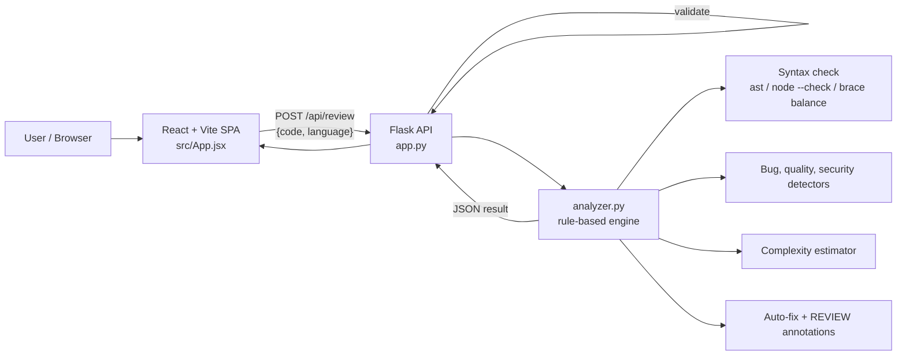

# AI Code Review Assistant

A web app that reviews a pasted code snippet and reports **bugs, code-quality issues, security problems and estimated complexity**, together with a 0–10 score and an auto-fixed, annotated version of the code.

> **How the "AI" works today:** the review engine (`analyzer.py`) is a local, **rule-based static analyser** built on regular expressions, Python's `ast` module and brace/indentation heuristics. It makes **no LLM or external API calls**. `app.py` contains a marked place where an LLM-backed reviewer could replace it, but that is not implemented.

## Table of Contents

- [Overview](#overview)
- [Problem Statement](#problem-statement)
- [Key Features](#key-features)
- [Technology Stack](#technology-stack)
- [System Architecture](#system-architecture)
- [Project Structure](#project-structure)
- [Prerequisites](#prerequisites)
- [Installation](#installation)
- [Configuration](#configuration)
- [Running Locally](#running-locally)
- [API Reference](#api-reference)
- [Testing](#testing)
- [Example Usage](#example-usage)
- [Deployment](#deployment)
- [Security Considerations](#security-considerations)
- [Known Limitations](#known-limitations)
- [Future Improvements](#future-improvements)
- [Contributing](#contributing)

## Overview

The frontend is a React single-page app with a CodeMirror editor. The user picks a language, pastes code and submits it to a Flask API (`POST /api/review`). The API validates the request, runs the analyser and returns structured findings that the UI renders as a score, a severity chart, per-category finding lists and a refactored version of the code.

Supported languages: **Python, JavaScript, C++, Java, Go**.

## Problem Statement

Quick feedback on a snippet usually means setting up a linter per language or waiting for a human review. This project offers a single place to paste code in several languages and immediately see likely bugs, risky patterns (hardcoded secrets, SQL built by string concatenation, `eval`, …) and a rough complexity estimate, with mechanical fixes applied automatically.

## Key Features

- **Bug detection** – bare `except:`, mutable default arguments, unguarded division by a collection length, `<=` loop bounds against a length (off-by-one), unchecked Go errors, empty `catch` blocks.
- **Syntax checking** – real parsing for Python (`ast`) and JavaScript (`node --check`, when Node.js is installed on the server); brace/bracket balance checks for Java, C++ and Go.
- **Security checks** – hardcoded credentials, SQL built via concatenation/interpolation, and dangerous calls (`eval`, `exec`, `os.system`, `shell=True`, `pickle.loads`, `yaml.load`).
- **Quality checks** – leftover TODO/FIXME, debug prints, `range(len(...))`, `var` and loose equality in JavaScript, functions longer than 40 lines.
- **Complexity estimate** – heuristic time/space complexity (nested loops, sorting, recursion, collection growth) with a short explanation.
- **Score and verdict** – severity-weighted 0–10 score (a syntax error forces 0; high-severity security findings dominate the verdict).
- **Auto-fix and annotate** – safe mechanical rewrites (e.g. `== None` → `is None`, `var` → `let`, `yaml.load` → `yaml.safe_load`, mutable defaults → `None` guard, off-by-one bounds, hardcoded secrets → environment lookups, debug prints removed); remaining issues are inserted as `REVIEW:` comments.
- **UI** – CodeMirror editor with per-language highlighting, severity chart (Recharts), copy-to-clipboard for the refactored code.

## Technology Stack

| Layer | Technology |
|-------|------------|
| Backend | Python, Flask 3.0.3, Flask-CORS 4.0.1 |
| Analysis | Python standard library (`re`, `ast`, `subprocess`); optional Node.js for JS syntax checks |
| Frontend | React 18, Vite 5, Tailwind CSS 3, `@uiw/react-codemirror`, Recharts |
| Testing | pytest |
| Deployment config | Vercel (`vercel.json`: `@vercel/python` + `@vercel/static-build`) |

## System Architecture



In development, Vite proxies `/api` to `http://localhost:5000` (`vite.config.js`). On Vercel, `/api/*` is routed to `app.py` and everything else is served from the static build.

## Project Structure

```
.
├── app.py                  # Flask API: validation, /api/review, /api/health
├── analyzer.py             # Rule-based analysis engine and auto-fixer
├── requirements.txt        # Runtime Python dependencies
├── requirements-dev.txt    # Adds pytest
├── pytest.ini              # pytest configuration
├── tests/
│   ├── test_analyzer.py    # Unit tests for the analysis engine
│   └── test_api.py         # Tests for the Flask endpoints
├── src/
│   ├── App.jsx             # Main UI and API call
│   ├── FindingsList.jsx    # Bugs / quality / security lists
│   ├── SeverityChart.jsx   # Severity chart
│   ├── Logo.jsx
│   ├── languages.js        # Language list, CodeMirror extensions, sample code
│   ├── main.jsx
│   └── index.css
├── public/favicon.svg
├── index.html
├── package.json            # Frontend scripts and dependencies
├── vite.config.js          # Dev server + /api proxy
├── tailwind.config.js
├── postcss.config.js
├── vercel.json             # Vercel build and routing
└── .env.example            # Optional environment variables
```

## Prerequisites

- Python 3 (tested with 3.13)
- Node.js 18+ and npm (for the frontend; Node on the API host also enables JavaScript syntax checking)

## Installation

```bash
git clone https://github.com/MageshS09/ai-code-review-assistant.git
cd ai-code-review-assistant

# Backend
python -m venv .venv
source .venv/bin/activate          # Windows: .venv\Scripts\activate
pip install -r requirements-dev.txt

# Frontend
npm install
```

## Configuration

All variables are optional. Copy `.env.example` for reference; the backend reads variables from the process environment (it does not load `.env` files automatically).

| Variable | Used by | Default | Purpose |
|----------|---------|---------|---------|
| `FLASK_DEBUG` | `app.py` | `0` | Set to `1` for Flask's debugger/reloader in local development only. |
| `FLASK_HOST` | `app.py` | `127.0.0.1` | Interface to bind when running `python app.py`. |
| `PORT` | `app.py` | `5000` | Port for `python app.py`. |
| `CORS_ORIGINS` | `app.py` | `*` | Comma-separated allowed origins. |
| `VITE_API_BASE_URL` | frontend | *(empty)* | API base URL when not served from the same origin. |

There is no database and no API key requirement.

## Running Locally

Terminal 1 – API:

```bash
FLASK_DEBUG=1 python app.py       # http://127.0.0.1:5000
```

Terminal 2 – frontend:

```bash
npm run dev                        # http://localhost:5173 (proxies /api to :5000)
```

Production build of the frontend: `npm run build` (output in `dist/`).

## API Reference

### `POST /api/review`

Request body (JSON object):

| Field | Type | Rules |
|-------|------|-------|
| `code` | string | Required, non-empty after trimming, at most 20,000 characters |
| `language` | string | Required, case-insensitive; one of `python`, `javascript`, `cpp`, `java`, `go` |

Responses: `200` with the review below, or `400` with `{"error": "..."}` for a non-object body, wrong field types, empty code, unsupported language or oversize code.

```json
{
  "bugs":      [{"line": 1, "description": "...", "severity": "medium"}],
  "quality":   [{"line": 3, "description": "...", "severity": "low"}],
  "security":  [{"line": 2, "description": "...", "severity": "high"}],
  "complexity": {"time": "O(n^2)", "space": "O(1)", "explanation": "..."},
  "refactored_code": "...",
  "score": 6,
  "verdict": "Functional but has notable bugs or quality issues that should be fixed."
}
```

`severity` is `high`, `medium` or `low`. Rule-based findings are heuristics and can be false positives or negatives.

### `GET /api/health`

Returns `{"status": "ok"}`.

## Testing

```bash
python -m pytest
```

The suite covers each detector, the auto-fixers (including regression tests for the cases listed in the changelog below), the complexity estimator, scoring, and the API's validation behaviour.

## Example Usage

```bash
curl -s -X POST http://127.0.0.1:5000/api/review \
  -H "Content-Type: application/json" \
  -d '{"language": "python", "code": "api_key = \"abcd1234\"\ndef f(items=[]):\n    return sum(items) / len(items)\n"}'
```

This reports a high-severity hardcoded credential, a high-severity mutable default argument, and a medium-severity unguarded division.

## Deployment

`vercel.json` builds `app.py` with `@vercel/python` and the Vite app with `@vercel/static-build`, routing `/api/*` to Flask. JavaScript syntax checking needs `node` on the API host; if it is unavailable the check is skipped and only the pattern-based JavaScript checks run. The deployment configuration has not been verified as part of this audit.

## Security Considerations

- Submitted code is **analysed as text and never executed**. The only external process is `node --check` on a temporary file for JavaScript syntax checking (5-second timeout, file deleted afterwards).
- Input is validated for type, emptiness, language and length (20,000 characters).
- `python app.py` binds to `127.0.0.1` with debug **off** by default; the Werkzeug debugger permits arbitrary code execution and must not be exposed.
- CORS is open (`*`) by default; set `CORS_ORIGINS` when the frontend is on another origin.
- There is **no authentication or rate limiting**; add them before exposing the API publicly.

## Known Limitations

- Heuristic, not a real parser (except Python's `ast` and Node's `--check`): expect false positives and misses, especially in Java, C++ and Go.
- Complexity is estimated from loop nesting, recursion and sort calls only.
- Auto-fixes are text rewrites. Review them before use; the output may not preserve all formatting (for example, a trailing newline).
- Only single snippets are analysed (no multi-file context).
- No screenshots are included because none exist in the repository.
- The repository currently declares no license.

## Future Improvements

- Optional LLM-backed review behind the existing `analyze_code` interface (the hook point is commented in `app.py`).
- AST-based analysis for more languages (for example `tree-sitter`).
- Rate limiting and authentication for public deployments.
- Frontend tests and CI to run `pytest` and `npm run build` on each push.

## Contributing

1. Fork the repository and create a branch: `git checkout -b feature/my-change`.
2. Install dev dependencies (`pip install -r requirements-dev.txt`) and make your change.
3. Add or update tests in `tests/` and run `python -m pytest`.
4. For frontend changes, verify `npm run build` succeeds.
5. Open a pull request describing the change and its motivation.

## Changelog Highlights (audit)

- API now returns `400` instead of `500` for non-object bodies and non-string `code`/`language`.
- Debug mode and `0.0.0.0` binding are no longer the default when running `python app.py`.
- Division-by-length detection is no longer suppressed by words that merely contain "if" (e.g. "verify").
- Auto-fix no longer produces Python with an empty block after removing a lone `print`.
- `else if (...) {` is no longer mistaken for a function definition in Java/C++.
